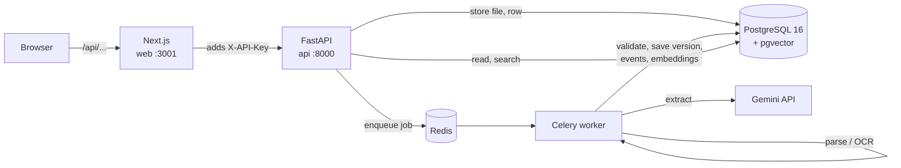
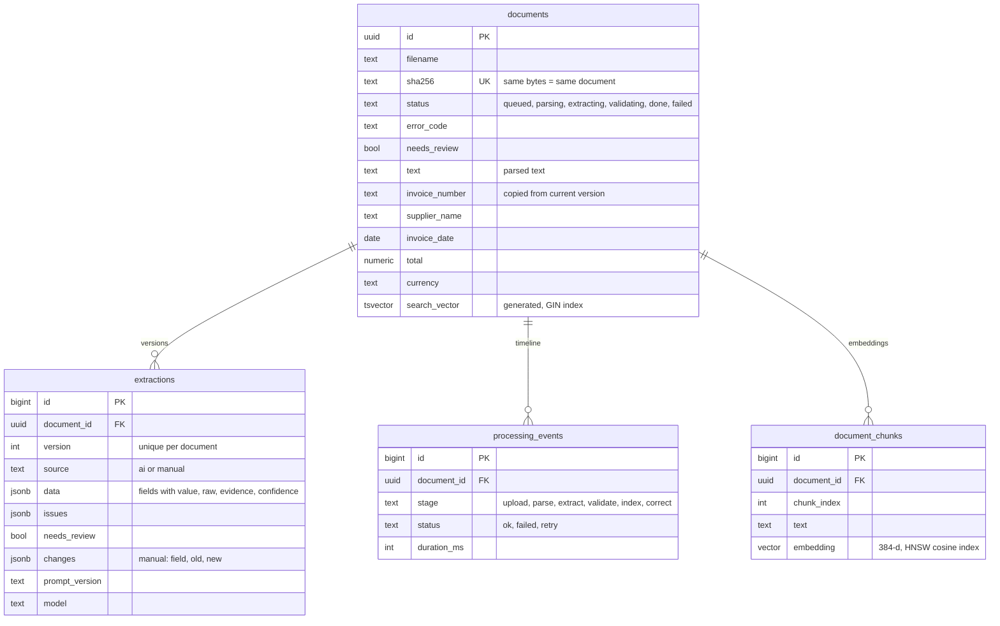

# CareGuide Document Intelligence

Upload invoices as PDF, scanned image, Excel or CSV; the system extracts the key fields with an LLM, checks them with validation rules, flags anything doubtful for human review, and makes every document searchable by keyword and by meaning.

**Measured on 60 labelled files:** 99.2% of fields correct (PDF 100%, scans 98.3%), 100% of documents processed, all 10 planted errors flagged. Full report: [EVALUATION.md](EVALUATION.md).

## Deliverables: where to find everything

This repository contains every part of the assessment except the walkthrough video, which is shared as a Google Drive link. Here is where each deliverable lives and the quickest way to check it.

**1. Source code.** Everything is in this repository. The backend (FastAPI, Celery worker, pipeline, AI extraction, validation, search) is in `backend/app/`, and the web app is in `frontend/`. The [Project layout](#project-layout) section below explains each folder.

**2. README and setup.** You are reading it. The [Quick start](#quick-start) section takes you from `git clone` to a running system with one `docker compose up`. You only need Docker and a free Gemini API key.

**3. Architecture diagram and database schema.** Both are drawn in this README ([Architecture](#architecture) and [Database schema](#database-schema)) and render directly on GitHub. The schema in code is `backend/app/db/models.py`, and the migrations that create it are in `backend/alembic/versions/`.

**4. Working backend API and frontend.** Start the system with the Quick start, then open the web app at http://localhost:3001 and the interactive API documentation at http://localhost:8000/docs. The API is in `backend/app/api/` (documents, corrections, reprocessing and search endpoints), and the four screens (Upload, Documents, Review, Search) are in `frontend/app/`. The walkthrough video shows all of it in use.

**5. PDF, image, Excel and CSV pipelines.** Parsing is in `backend/app/pipeline/`: PDFs are read from their text layer with PyMuPDF, scans and images are cleaned with OpenCV and read with Tesseract OCR, and Excel and CSV files are read with pandas and openpyxl. AI extraction is in `backend/app/extraction/`, validation in `backend/app/validation/`, and the worker that runs the stages in order is `backend/app/services/processing.py`.

**6. Automated tests and results.** There are 249 tests in `backend/tests/`, covering parsing, extraction with a fake model (so no network is needed), the validation rules and 21 edge cases, the API, the worker, search and the evaluation scoring. The full output of the last run is in [docs/test_results.txt](docs/test_results.txt). To run them yourself, see Quick start.

**7. Evaluation report with measured metrics.** [EVALUATION.md](EVALUATION.md) reports extraction accuracy per field and per format, processing time per stage with percentiles, and success and failure rates, all measured end to end on 60 labelled files. The raw output of that run is [docs/eval_run.md](docs/eval_run.md). The script that produced it is `backend/scripts/run_eval.py`, the scoring rules are in `backend/app/evaluation/scoring.py`, and the labelled dataset is in `backend/eval_data/`.

**8. Recorded walkthrough.** A video of about 9 minutes showing the system working, its architecture, the code, the tests and the evaluation: [Google Drive link](PASTE-DRIVE-LINK).

**9. AI prompts and AI-assisted development.** The extraction prompts are versioned files (`extract_invoice_v1.md` to `extract_invoice_v3.md`); every stored extraction records which prompt version produced it. How I used AI while building the project, phase by phase, and what I did myself, is described in [docs/AI_USAGE.md](docs/AI_USAGE.md). My own notes and measurements from each phase are in [docs/notes.md](docs/notes.md).

**Walkthrough video:** 

## Quick start

Requirements: Docker Desktop (with WSL2 on Windows) and a free Gemini API key from Google AI Studio.

```bash
git clone <this repo>
cd careguide-docintel
cp .env.example .env            # then set GEMINI_API_KEY and API_KEY in .env
docker compose up -d --build
docker compose run --rm api alembic upgrade head
```

| What | Where |
| --- | --- |
| Web app | http://localhost:3001 |
| API docs (Swagger) | http://localhost:8000/docs (send `X-API-Key`) |

The first start downloads the npm packages and, on the first upload, the embedding model (about 70 MB).

Run the tests:

```bash
docker compose exec postgres sh -c 'createdb -U "$POSTGRES_USER" docintel_test'   # once
docker compose run --rm --no-deps api python -m pytest -q
```

Run the evaluation (uploads 60 labelled files, about 10 minutes on the free tier):

```bash
docker compose run --rm --no-deps api python scripts/run_eval.py > docs/eval_run.md
```

## What it does

1. **Upload** many files at once (drag and drop, per-file progress). Same bytes are recognised and not processed twice.
2. **Parse**: PDF text layer with PyMuPDF; scans and images with OpenCV clean-up and Tesseract OCR; Excel and CSV with pandas/openpyxl.
3. **Extract**: Gemini returns structured JSON (invoice number, date, supplier, customer, subtotal, tax, total, currency, line items, adjustments), each value with the exact text it was read from as evidence.
4. **Validate**: arithmetic (subtotal + tax = total, line sums), ISO currency, impossible or ambiguous dates, missing fields, and duplicates against earlier invoices. Each problem is an issue with a code, severity, expected and found value; any error sets `needs_review`.
5. **Review**: the original file next to the extracted fields, evidence highlighted in the text, issues you can click to jump to the field, manual corrections saved as a new version, and a timeline of every processing step.
6. **Search**: keyword (Postgres full text), semantic (pgvector embeddings) and hybrid (reciprocal rank fusion), with filters for supplier, currency, dates, total and review state.

## Architecture



- **The browser never sees the API key.** It calls the Next.js server, whose route handler adds the key and forwards to FastAPI. That keeps the key secret and removes the need for CORS.
- **Uploads return at once.** Processing runs in a Celery worker, one stage at a time, and each stage commits its result. A Gemini 503 or 429 puts the job back on the queue with a delay (2, 4, 8 min); other errors fail the document with a stable error code, and failed documents can be reprocessed.
- **The UI polls** every 2 seconds only while something is processing.

## Database schema



Extractions are never overwritten: every AI run and every correction is a new version, so the history shows who changed what.

## Design decisions

| Decision | Why |
| --- | --- |
| Gemini free tier, `gemini-3.5-flash-lite`, JSON-schema output | No cost; structured output removes JSON parsing errors. Behind an `LLMClient` interface, so the provider can change. |
| Evidence for every value | A value whose evidence is not in the document text is rejected, which catches hallucinations. |
| Rules, not model confidence, decide review | Gemini reports near 100% confidence even when wrong; arithmetic and format rules catch real errors. |
| Worker concurrency 1 | Keeps within the free tier's 15 requests per minute. More workers and a paid tier scale it. |
| Postgres for everything | Documents, versions, events, full-text and vector search in one database: simpler to run and back up. |
| Polling instead of WebSockets | Enough for one reviewer; Server-Sent Events would be the next step. |

## Results and tests

- [EVALUATION.md](EVALUATION.md): accuracy, processing time, success and failure rates, measured end to end.
- [docs/test_results.txt](docs/test_results.txt): 249 automated tests (parsing, extraction with a fake LLM, validation rules and 21 edge cases, API, processing, search, scoring).

## Project layout

```
backend/app/       api, pipeline (parsing), extraction, validation, services, search, workers, db, evaluation
backend/tests/     pytest suite
backend/scripts/   dataset generation, evaluation, reindex
backend/eval_data/ 30 labelled invoices (PDF + scan + JSON)
frontend/          Next.js app (upload, documents, review, search)
docs/              notes, AI usage, test and evaluation output
```

## Deployment

Runs locally with Docker Compose. A hosted version needs a long-running API and worker, so the plan is: frontend on Vercel, API and worker as containers on Render or Railway, Postgres with pgvector on Neon or Supabase, Redis on Upstash, and a paid Gemini tier. Vercel alone cannot run the worker, Tesseract or Celery.

## AI-assisted development

This project was built with help from Claude (Anthropic) as a mentor: phase guides, code drafts and explanations, which I ran, tested, debugged and can explain. Details per phase are in [docs/AI_USAGE.md](docs/AI_USAGE.md). The extraction prompts are versioned in `prompts/` (`extract_invoice_v1.md` to `v3.md`).

## Known limits

- Evaluated on 60 synthetic files; real documents will be harder.
- One invoice per file; several invoices in one PDF are not split.
- Semantic search chunks are not rebuilt after a manual correction (keyword search and filters are).
- Free-tier Gemini adds 503 waits; throughput is about 5 files per minute with one worker.